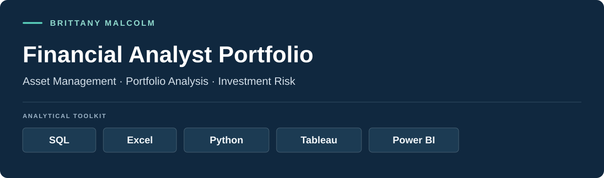
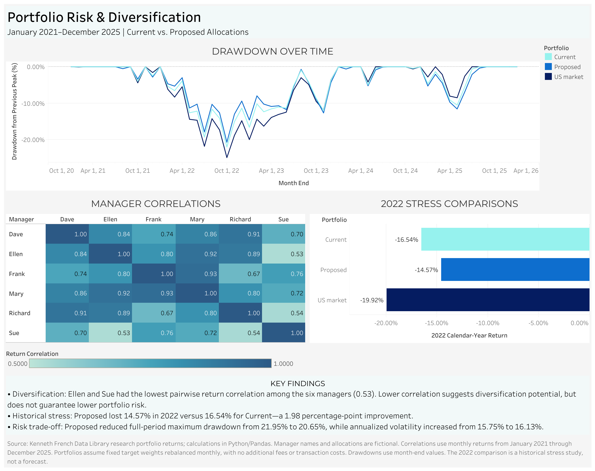

<p align="center">
  <a href="#featured-projects">Explore the projects</a> ·
  <a href="https://public.tableau.com/views/PortfolioRiskDiversification/PortfolioRiskDiversification">Interactive dashboard</a> ·
  <a href="#contact">Contact</a>
</p>

## Introduction

Welcome to my Financial Analyst Portfolio. My focus is on using financial data to evaluate investment performance, understand portfolio risk, and communicate findings that support informed allocation decisions.

This portfolio brings together work relevant to asset management and portfolio analysis:

- **Investment performance:** compounded returns, benchmark comparisons, and clear explanations of results.
- **Portfolio construction:** manager allocations, diversification, correlations, and contributions to risk.
- **Investment risk:** volatility, drawdowns, and historical stress analysis.
- **Manager oversight:** data-quality checks, allocation limits, and diligence-review monitoring.
- **Stakeholder reporting:** interactive dashboards and concise assessments of investment trade-offs.

SQL, Excel, Python, Tableau, and Power BI form the toolkit highlighted here. The four featured projects demonstrate PostgreSQL, Python/Pandas, Power BI, and Tableau through one connected investment case study.

## Featured investment study

**What changes when a hypothetical multi-manager equity portfolio reallocates 10 percentage points from a large-growth proxy to a small-value proxy?**

PostgreSQL establishes data and oversight controls, Python quantifies the allocation trade-offs, and Power BI and Tableau communicate the results. The study uses 60 months of public research portfolio returns, six fictional managers, and two allocation scenarios.



## Featured projects

| Project | Business question | Tools | Deliverables |
|---|---|---|---|
| [01 · Manager oversight](01_PostgreSQL_Manager_Oversight/) | Are return records complete, allocations compliant, and diligence reviews current? | PostgreSQL, pgAdmin | SQL views, exception report, schema diagram, validation checklist |
| [02 · Diversification and historical stress](02_Python_Portfolio_Study/) | Does reallocating from Sue to Ellen improve portfolio outcomes? | Python, Pandas, NumPy, Matplotlib | Executed notebook, script, metrics, correlations, risk contributions |
| [03 · Manager portfolio review](03_PowerBI_Manager_Review/) | How can an advisor explain the allocation changes and performance trade-offs? | Power BI, Power Query, DAX | Interactive scenario selector, performance cards, allocation chart, commentary |
| [04 · Portfolio risk and diversification](04_Tableau_Risk_Dashboard/) | How did the portfolios behave during losses and the 2022 downturn? | Tableau Public | Drawdown chart, correlation heatmap, historical stress comparison |

## Key findings

| Metric | Current | Proposed |
|---|---:|---:|
| Annualized return | 12.77% | 12.63% |
| Annualized volatility | 15.75% | 16.13% |
| Maximum drawdown | −21.95% | −20.65% |
| Calendar-year 2022 return | −16.54% | −14.57% |
| Sue's allocation | 40% | 30% |
| Ellen's allocation | 0% | 10% |

The proposed allocation brings Sue below the illustrative 35% allocation limit and reduces the 2022 loss by **1.98 percentage points**. It also improves historical maximum drawdown, while slightly reducing annualized return and increasing volatility. Differences are calculated before rounding.

This is a trade-off, not a universal risk improvement. Ellen remains a candidate subject to onboarding. Her proxy's correlation with Sue rises from **0.53 over the full study** to **0.80 during 2022**, illustrating how diversification can weaken in stress.

## Skills demonstrated

- **Data controls:** expected-record calendars, duplicate detection, allocation checks, benchmark mapping, JSON validation.
- **Portfolio analytics:** geometric compounding, covariance-based volatility, risk contributions, drawdowns, correlations, historical stress analysis.
- **Reporting:** Power Query transformations, relationships, DAX measures, Tableau heatmaps and time-series views.
- **Communication:** decision-focused findings, reproducible calculations, explicit assumptions, and interpretation of competing risk measures.

## Data and methodology

Returns are research proxies from the [Kenneth French Data Library](https://mba.tuck.dartmouth.edu/pages/faculty/ken.french/data_library.html), not actual manager track records. The six proxies represent U.S. equity size/value styles. Manager names, allocations, reviews, and policy limits are fictional.

The observation window is January 2021–December 2025. Both portfolios rebalance monthly to fixed weights. The study models no additional fees, trading costs, taxes, or external cash flows. The U.S. market benchmark is Mkt-RF + RF. Drawdowns use month-end values and omit intra-month losses.

The allocation comparison is retrospective, not a forecast or an out-of-sample strategy test. It is not a hedge-fund holdings or liquidity model. [Data documentation and provenance](data/README.md).

## Explore the work

- [Interactive Tableau dashboard](https://public.tableau.com/views/PortfolioRiskDiversification/PortfolioRiskDiversification)
- [Power BI workbook](03_PowerBI_Manager_Review/Manager_Portfolio_Review.pbix)
- [Tableau packaged workbook](04_Tableau_Risk_Dashboard/Portfolio_Risk_Diversification.twbx)
- [Executed Python notebook](02_Python_Portfolio_Study/portfolio_diversification.ipynb)
- [SQL exception report](01_PostgreSQL_Manager_Oversight/exception_report_2025-12-31.csv)
- [SQL validation results](01_PostgreSQL_Manager_Oversight/validation_checklist.csv)

## Repository layout

```text
investment-analytics-portfolio/
├── README.md
├── data/
├── images/
├── 01_PostgreSQL_Manager_Oversight/
├── 02_Python_Portfolio_Study/
├── 03_PowerBI_Manager_Review/
└── 04_Tableau_Risk_Dashboard/
```

## Contact

I welcome conversations about Financial Analyst opportunities focused on asset management, portfolio analysis, investment risk, and reporting.

- **GitHub:** [brjmalc](https://github.com/brjmalc)
- **LinkedIn:** [Brittany Malcolm](https://www.linkedin.com/in/brittanyjmalcolm/)
